# 智能旅行助手 · 基于大模型 Agent 的 MBTI 个性化旅行规划服务

一个基于大模型 Agent（Function Calling）与 MBTI 个性化的旅行规划应用。输入城市、天数、到达离开时间和个人偏好，它会生成一份带真实图片、地图、交通、预算和完整时间线的行程。

## 为什么做这个

做这个项目，起因其实很朴素：现在网上的旅行攻略大多是通用的，不会关心你是谁、和谁一起去、预算多少、几点到几点走。真正安排一趟旅行，往往要同时开好几个 App——查景点、查路线、找美食、订住宿，信息是散的，最后还得自己拼。

这个项目想做的，就是把这些都串起来，并且真正按"人"来定制，而不是给所有人一份差不多的攻略。

## 主要功能

### 按 MBTI 定制路线，还能算团队默契度

这是整个项目最核心、也最特别的地方。用户可以为同行的每个人填写各自的 MBTI，系统会从几个维度（内外向是否平衡、计划型和随性型是否搭配、角色是否互补、相处是否和谐）给这个团队打一个默契度分，并给出具体建议，比如"团队里缺一个偏计划型的人，加一个 ISTJ 负责统筹会更顺"。

效果上，同一座城市，换一套 MBTI 组合，出来的路线风格会明显不同。这一点很直观，也是它和普通攻略类产品拉开差距的地方。

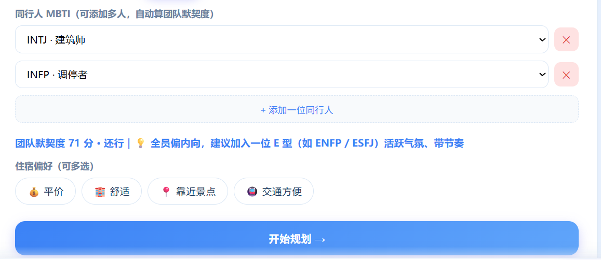

### 数据是真实的，不是编出来的

景点、美食、住宿的信息都来自高德的真实接口，带实拍图和坐标。天气、地铁公交线路（具体到几号线、上下车站、票价）、打车费也都是实时查询的。每个景点还附带两行说明，一行是推荐理由，一行是踩坑提醒，方便用户快速判断值不值得去。

### 从到达到离开，时间都排清楚了

用户填了"几点下高铁、几点走"，行程就会精确到小时，三餐齐全，中间还穿插咖啡馆、茶馆这类休息点。一些细节也会自动处理：比如下午两点半才到，当天就只安排晚餐；傍晚五点走，最后一天就不再安排晚餐。

### 能保存，也能事后回顾

行程可以一键保存。旅行结束之后，还能上传照片、写下感受，形成自己的旅行记录。

## 功能展示

下面按实际使用流程，逐个功能看一下。

### 首页

首页通过一个吉祥物和一张思维导图，把应用能做的事直观地列了出来——景点、美食、住宿、交通、预算、MBTI 定制，一眼就能看懂。

### 输入需求

用户只需要输入目的地和天数。系统不会直接生成，而是先询问一系列个性化问题，再开始规划。

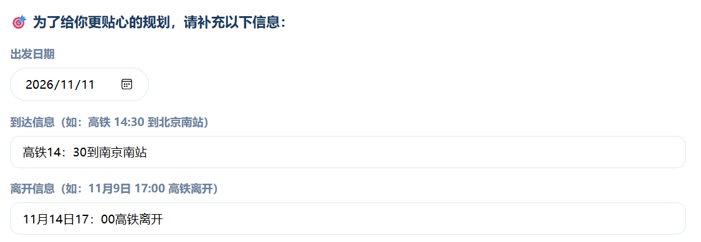

### 个性化问卷

问卷覆盖了多个维度的信息，每一项都会影响后续的路线和餐厅选择：

- 出行方式（自驾、高铁、飞机）、出发日期、到达和离开信息（具体到几点、哪个站）
- 同行人群、同行人数
- 口味偏好、住宿和餐饮预算
- 兴趣偏好、旅行主题（美食主线、看海发呆、城市人文、历史研学、citywalk）、旅行期望

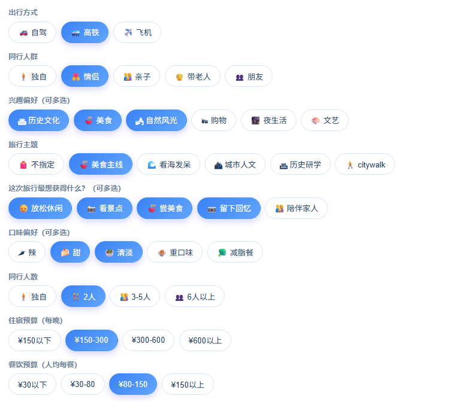

### 行程生成

确认信息后，模型会通过 Function Calling 自动调用多个真实工具——搜索景点、查天气、算交通路线，最后整合成一份结构化行程。

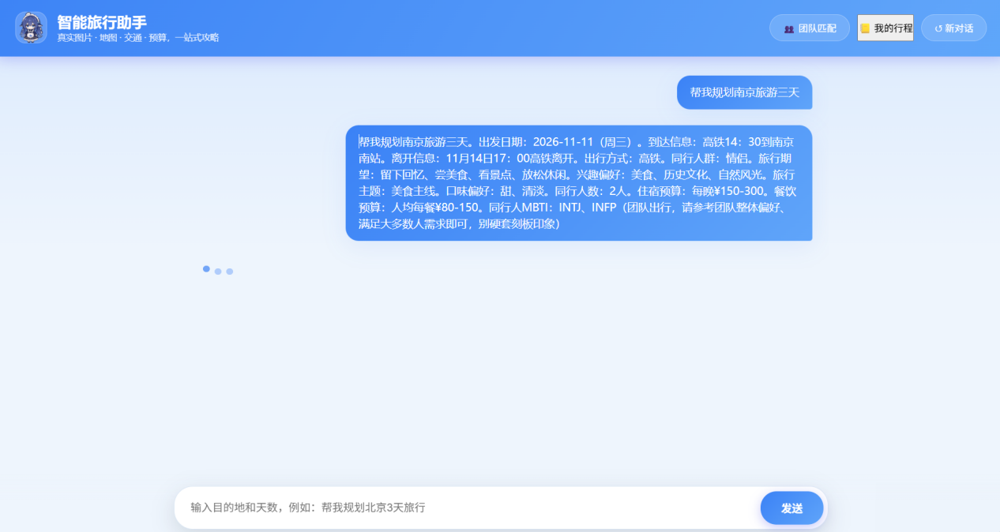

### 地图

所有景点都落在高德地图上，按天数标成 D1、D2、D3，可以缩放查看，景点之间的位置关系很清楚。

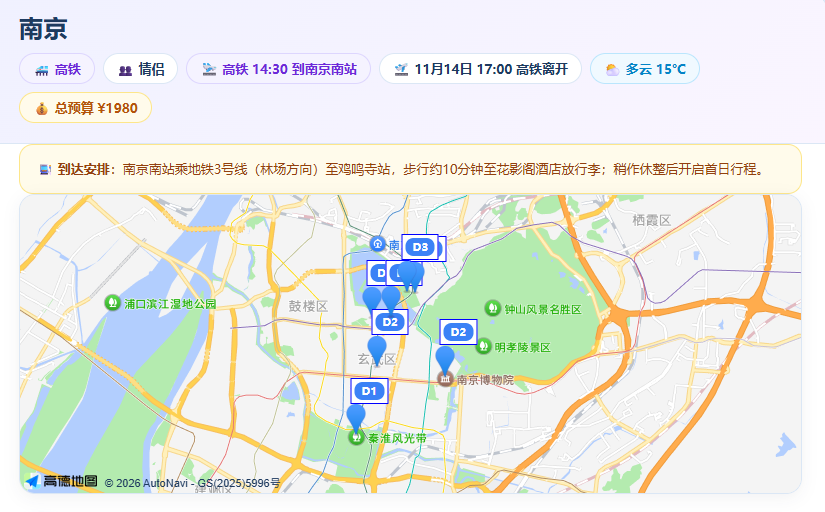

### 逐日行程

每天的行程都精确到小时。景点卡片里有真实图片（可以点击放大）、建议游览时间、推荐亮点、踩坑提醒，以及怎么去（地铁几号线、打车多少钱）；餐饮卡片有招牌菜和价格；住宿卡片有价格和选择理由。

第一天是到达日。如果下午两点半才到，当天就只安排晚餐，不会出现不合常理的全天排满。

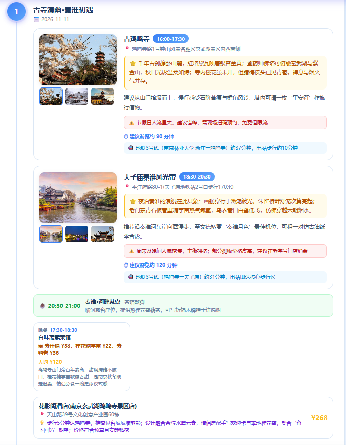

第二天是完整的一天，早中晚三餐齐全，景点之间穿插休息点，不至于全程赶路。

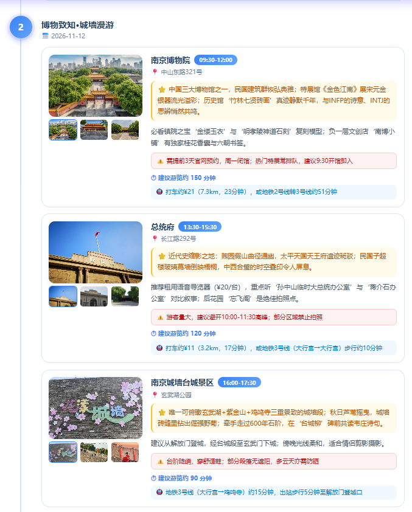

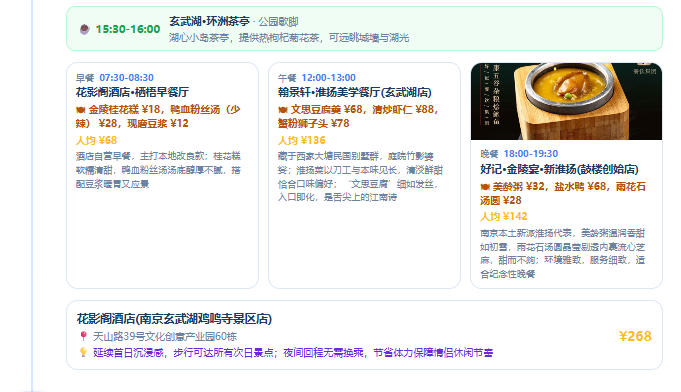

第三天是离开日。傍晚五点走，当天就不安排晚餐，收尾很顺。

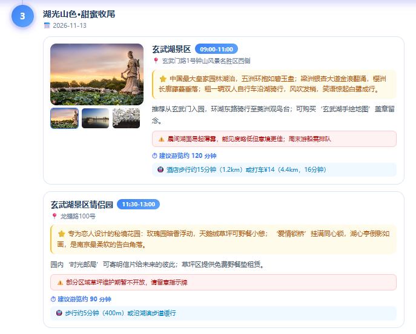

### 餐饮与实用建议

每餐都写了招牌菜和价格。行程末尾还有实用建议，比如哪些景点要预约、怎么坐地铁、天气怎么应对、返程要预留多久。

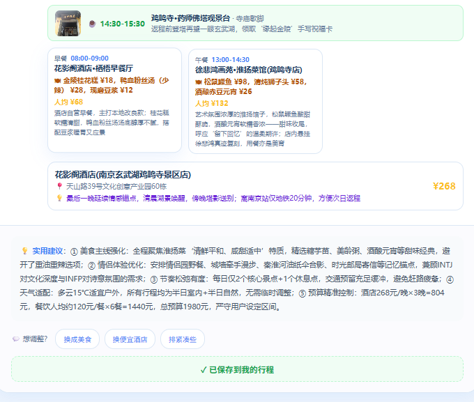

### 保存行程

生成好的行程可以一键保存到个人行程库。

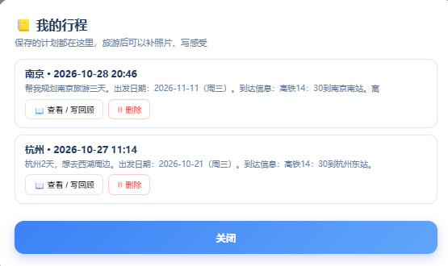

### 旅行回顾

在"我的行程"里能查看历史规划，旅行结束后可以上传照片、写下感受，形成自己的旅行日记。

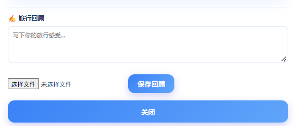

### 团队匹配度

一个独立的小工具。添加多个成员的 MBTI，就能实时算出团队的默契度，并给出分项评分和优化建议。

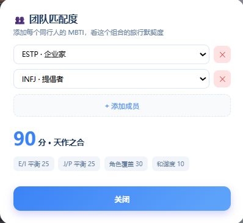

## 技术实现

后端用的是 FastAPI，核心是一个 Function Calling 的 Agent 循环：模型先输出要调用的工具，程序去执行（比如调高德接口），再把结果回填给模型，如此反复，直到模型给出最终答案。整个过程不是写死的流程，而是模型自己决定每一步做什么。

另外做了几件事：对话历史持久化，支持"把第二天换成美食"这类追问；约束模型输出 JSON，并加了完整性校验——如果天数不够、三餐不齐，会自动追问补全；高德这边接了 POI 搜索、天气、公交路线、驾车和打车费、POI 照片这几个接口。

技术栈：Python、FastAPI、Function Calling、高德地图 API、通义千问（qwen-plus）、原生 HTML/CSS/JS。

## 写在最后

这个项目把大模型 Agent 的能力落到了一个真实的场景里，并且用 MBTI 个性化和团队匹配度做出了自己的特色。从填问卷、生成行程、可视化展示，到保存和事后回顾，整套流程是完整的，也体现了一定的工程能力。
